<p align="center">
  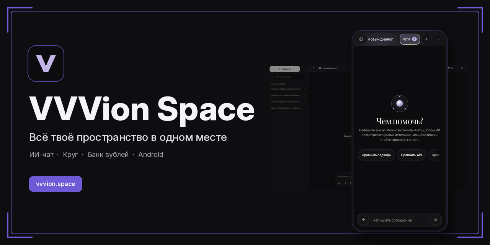
</p>

<h1 align="center">VVVion Space</h1>

<p align="center">
  ИИ-чат, общение и сервисы на <a href="https://vvvion.space">vvvion.space</a>
</p>

<p align="center">
  <a href="https://vvvion.space"></a>
  
  
  
  
  
  
  
</p>

<p align="center">
  <a href="https://vvvion.space">Открыть сайт</a>
  ·
  <a href="https://vvvion.space/about">О проекте</a>
  ·
  <a href="https://vvvion.space/updates">Что менялось</a>
</p>

**VVVion Space** — это одно пространство, где можно спросить у модели, переписываться с людьми, почитать, посмотреть погоду и держать файлы. Интерфейс на русском, есть английский и қазақша. Тёмная и светлая темы.

Чат открыт сразу: напишите сообщение — ответ появляется в той же колонке. Без аккаунта можно задать **три вопроса**, дальше нужен вход. История диалогов вошедшего пользователя хранится в его аккаунте.

---

## ИИ-чат

Встроенный ассистент отвечает через сервер приложения. Модель выбирается в списке — на живом сайте это, в частности, DeepSeek, GLM, Qwen, GPT, Nemotron и Gemini. В одном окне можно искать по открытым источникам («Сеть»), попросить картинку, приложить файл, включить голос и подключить MCP-сервер по HTTPS (до четырёх адресов).

<p align="center">
  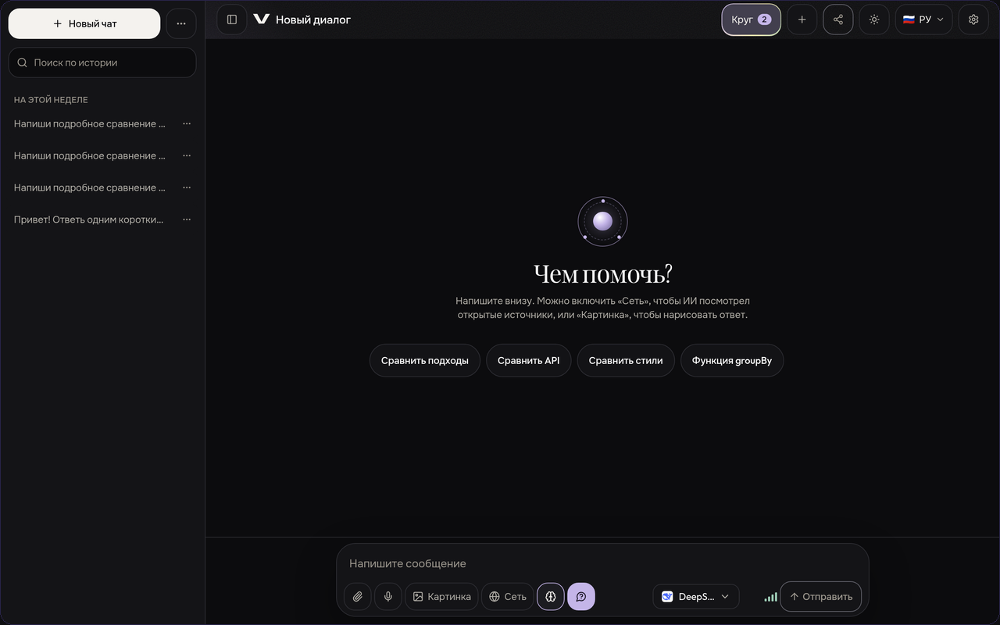
</p>

<p align="center">
  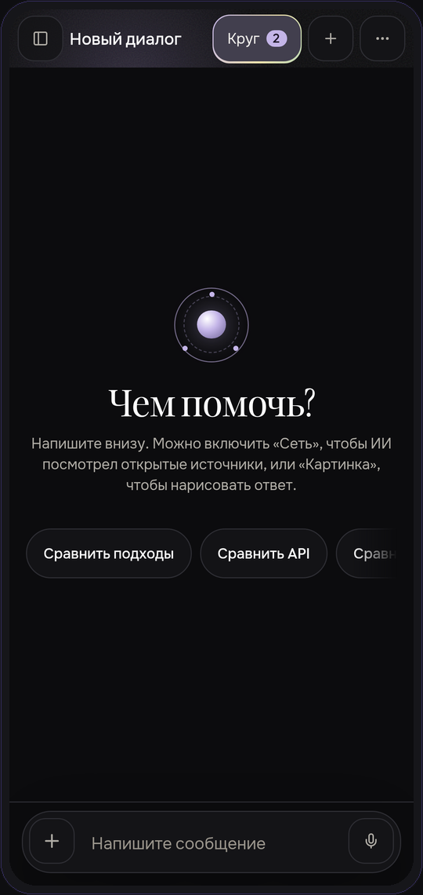
  &nbsp;&nbsp;&nbsp;
  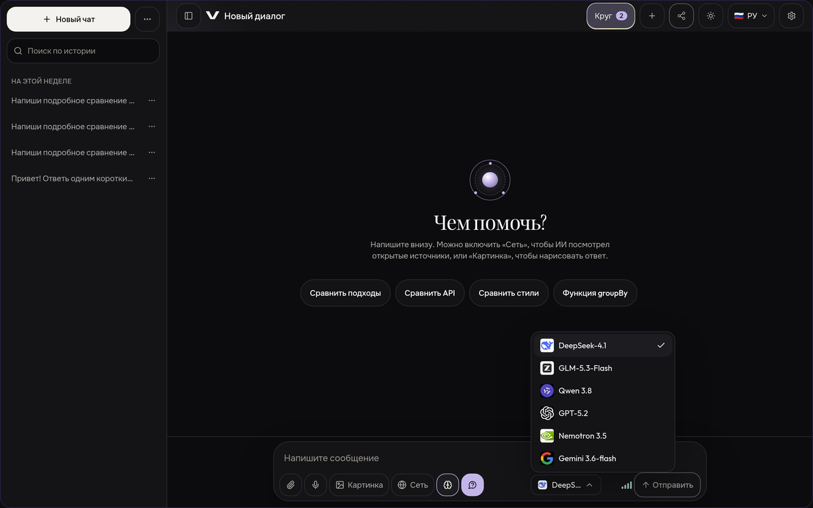
</p>

<p align="center">
  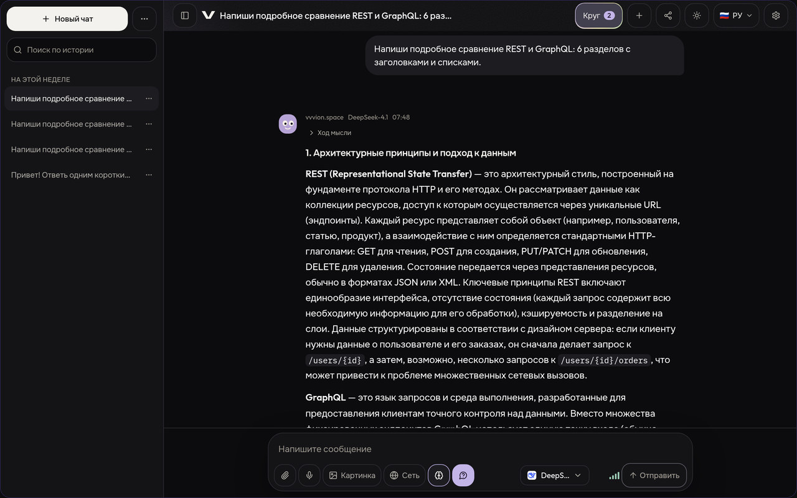
</p>

Своё подключение — любой HTTPS-сервер с Chat Completions. Ключ живёт в IndexedDB этого браузера, запросы идут через сервер приложения, чтобы обойти CORS: сервер ключ не записывает. Это не абсолютная защита. Пример без настоящего ключа: [`examples/provider.example.json`](examples/provider.example.json).

Встроенный ассистент ключ не показывает: он читается только на сервере из `XAI_API_KEY`. Тема, имя и активное подключение хранятся в `localStorage`. Локальные данные можно стереть в настройках.

---

## Круг

**Круг** — это сообщество внутри сервиса. Регистрация по почте и паролю. У каждого раздела свой адрес вида [`/c/messages`](https://vvvion.space/c/messages): ссылку можно отправить, и откроется именно он.

Семь разделов:

| Раздел | Что внутри |
| --- | --- |
| **Сообщения** | Личные диалоги и группы, голосовые, стикеры, файлы до 200 МБ |
| **Лента** | Короткие записи и ответы, картинки и музыка |
| **Развлечения** | Читальня (EPUB, FB2, TXT, PDF), смотрельня и игры |
| **Сервисы** | Погода, новости, курсы, VPN и загрузчик по ссылке |
| **Диск** | Картинки и голосовые из чата, папки, общая ссылка, Мегадиск |
| **Банк** | Вубли, переводы, карта и приглашения |
| **Магазин** | Подписка, место, запросы и персонажи |

<p align="center">
  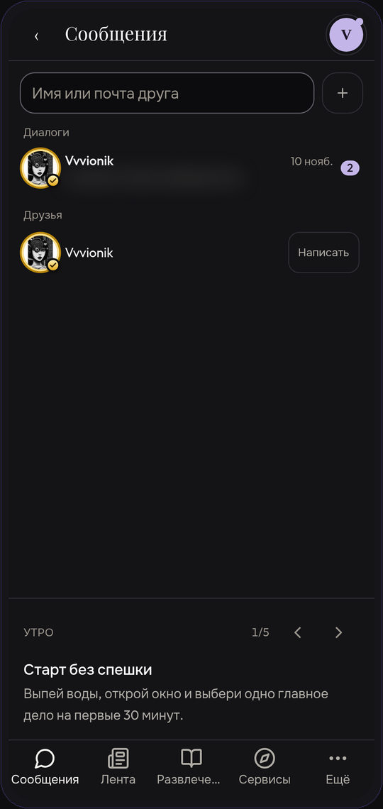
  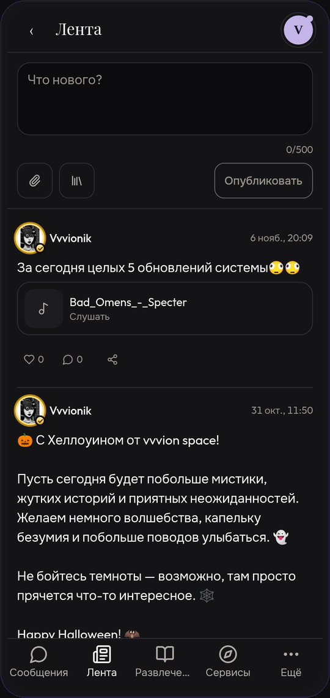
  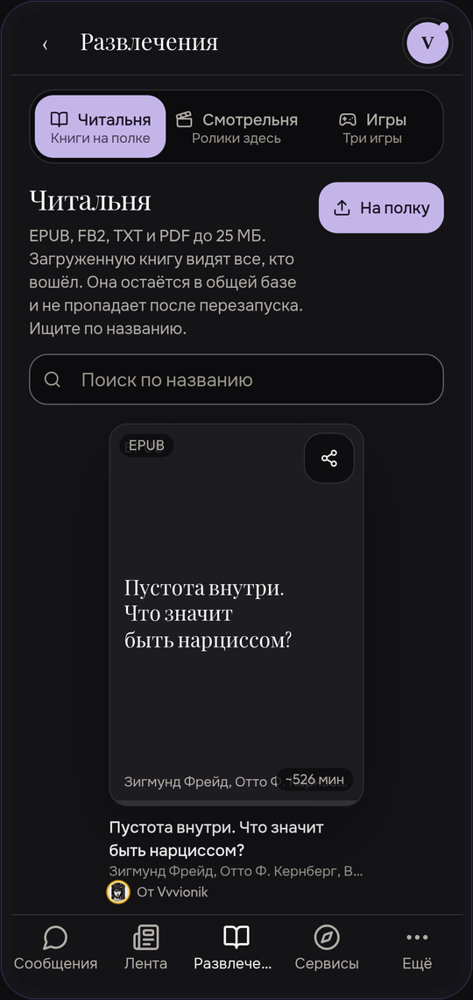
  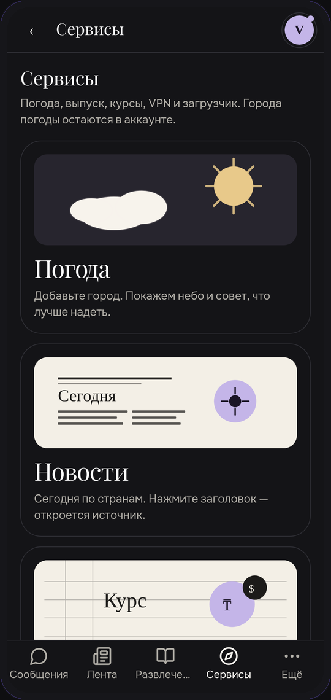
</p>

<p align="center">
  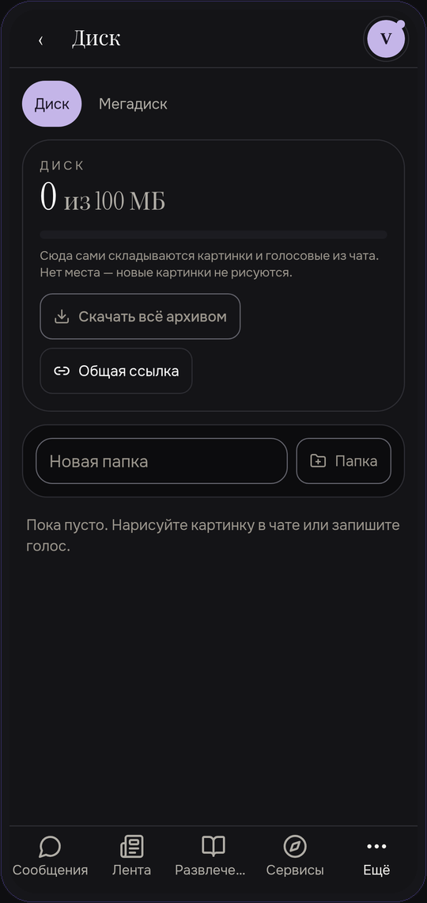
  &nbsp;&nbsp;&nbsp;
  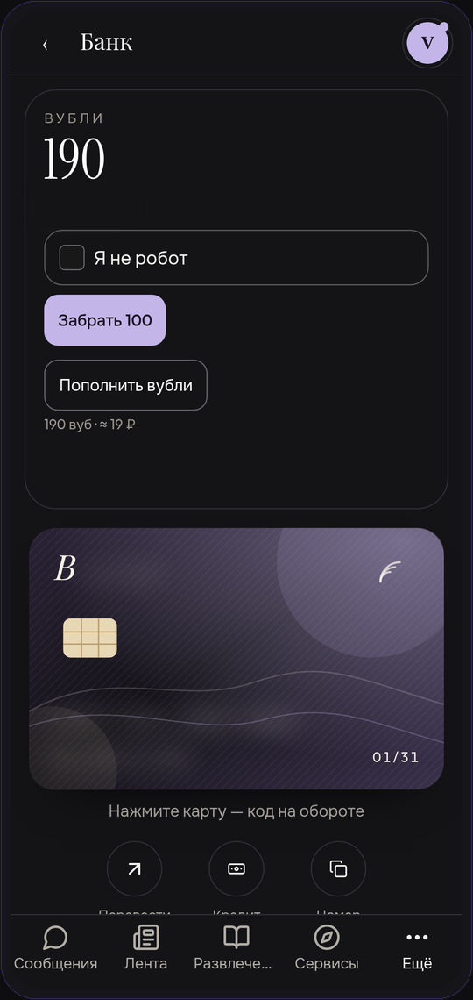
</p>

---

## Банк и вубли

**Вубли** — внутренняя мелочь сервиса, не рубли и не электронные деньги. На витрине курс **1 ₽ = 10 вублей**.

В банке видны баланс, перевод другу или по номеру, приглашения и ежедневные вубли («Забрать 100»). Кнопка «Пополнить вубли» открывает пополнение. Сама оплата через [Crypto Pay](https://help.crypt.bot/crypto-pay-api) (`@CryptoBot`) уже есть в коде и включается флагами окружения `PAY_TOPUP` и `CRYPTOPAY_ENABLED` — в примере они выключены, чтобы пустой деплой никого не тарифицировал.

---

## Магазин

Покупки идут за вубли. На витрине, среди прочего:

- **VVVION PREMIUM** — 30 дней: расширенный лимит, место на диске, все персонажи и окантовка аватара
- **VPN** — ссылка на 30 дней для Happ, Incy и Karing
- **Мегадиск** — 2 ГБ на 30 дней, отдельно от личного диска
- **Место на диске** — дополнительные 100 МБ
- **Сутки подлиннее** — дополнительные запросы к ИИ на 24 часа
- **Персонажи** для чата: психолог, Сократ, шеф и другие

Часть покупок доступна после подтверждения почты.

<p align="center">
  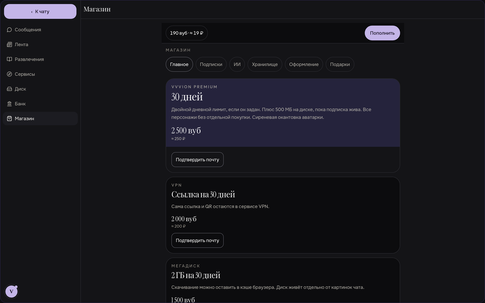
</p>

<p align="center">
  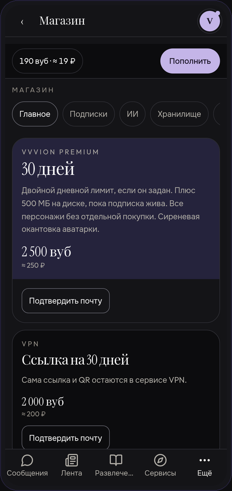
  &nbsp;&nbsp;&nbsp;
  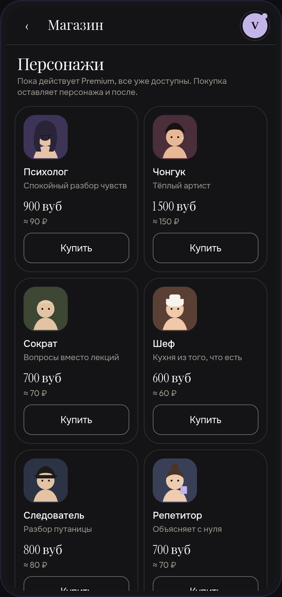
</p>

---

## Приложение для Android

Сайт ставится и как [PWA](https://vvvion.space/about) на телефон или компьютер, и как отдельное Android-приложение **VVVion Space** (`space.vvvion.app`): WebView той же площадки, уведомления через Firebase и установка APK с сайта (маршруты `/app`, Digital Asset Links).

---

## Как это устроено

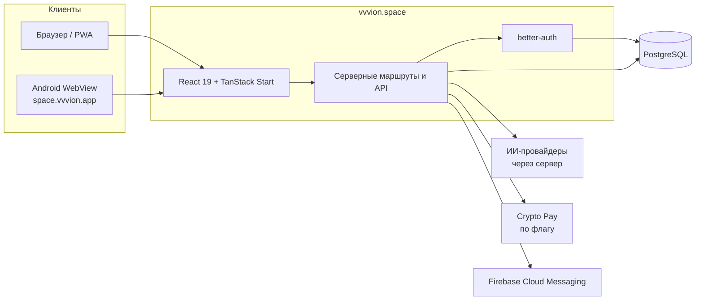

Клиент — React-приложение на TanStack Start и Router. Серверные функции и REST-маршруты живут в `src/routes/`. Учётные записи — через better-auth, данные — в PostgreSQL. Ключи моделей и платежного API на клиент не попадают.

---

## Стек

| Слой | Что используется |
| --- | --- |
| Интерфейс | React 19, TanStack Router / Start / Query, Tailwind CSS 4, Radix UI, Zustand |
| Сборка | Vite 8, TypeScript, Nitro |
| Авторизация | better-auth, почта и пароль, коды сброса через SMTP (Resend) |
| База | PostgreSQL 16, миграции в `migrations/`, скрипт `npm run db:migrate` |
| ИИ | Прокси на сервере, стрим ответов, свои OpenAI-совместимые подключения |
| Оплата | Crypto Pay API, вебхук и сверка по cron — за флагами |
| Пуш | Firebase Cloud Messaging, cron `/api/push/cron` |
| Хостинг | Vercel (регион `fra1`) или Docker / VPS |

---

## Структура репозитория

```text
├── src/
│   ├── components/yaronetic/   # чат, круг, магазин, банк, диск, сервисы
│   ├── lib/                    # auth, ai, pay, social, db и прочие модули
│   ├── routes/                 # страницы и API (TanStack Start)
│   ├── router.tsx
│   └── styles.css
├── migrations/                 # PostgreSQL, 0001 … 0046
├── scripts/                    # dev-обёртка, миграции, проверки
├── public/                     # иконки, PWA, robots, sitemap
├── server/middleware/          # служебный middleware
├── examples/provider.example.json
├── Dockerfile
├── docker-compose.yml
├── vercel.json
├── .env.example                # платежные флаги и лимиты пополнения
└── vps.env.example             # переменные для Docker / VPS
```

---

## Запуск локально

Нужны **Node.js 22** и PostgreSQL (для полной работы аккаунтов, круга и миграций).

```bash
npm install
npm run dev
```

Приложение слушает `0.0.0.0:8080`.

Проверка типов, тесты, линтер и сборка:

```bash
npm run typecheck
npm test
npm run lint
npm run build
```

`npm run build` собирает клиент и затем выполняет `npm run db:migrate`. Предпросмотр собранного приложения: `npm run preview`.

---

## Публикация

### Vercel

Продакшен живёт на [vvvion.space](https://vvvion.space). В [`vercel.json`](vercel.json) заданы регион `fra1`, заголовки безопасности и два cron-задания:

- `/api/push/cron` — каждый час
- `/api/cron/cryptopay-reconcile` — сверка счетов Crypto Pay, в 30-ю минуту часа

Секреты задаются в окружении Vercel, не в репозитории.

### Docker и VPS

Домены в compose: `https://vvvion.space` и запасной `https://vvvion-space.grok.me`. Аккаунты и полка книг лежат в томе `vvvion_pgdata`. Пересборка его не стирает. **Не используйте `docker compose down -v`**: флаг `-v` удаляет базу.

```bash
cp vps.env.example .env
docker compose up -d --build
```

Образ собирается на `node:22`, слушает порт 8080 и перед стартом применяет миграции. Порт на хосте задаётся `APP_PORT` (по умолчанию 8080).

---

## Переменные окружения

Имена и назначение — без значений. Секреты оставляйте пустыми в репозитории и задавайте только в окружении хоста. Полный список с подсказками: [`.env.example`](.env.example) и [`vps.env.example`](vps.env.example).

| Переменная | Зачем нужна |
| --- | --- |
| `DATABASE_URL` | Подключение к PostgreSQL |
| `POSTGRES_PASSWORD` | Пароль пользователя базы в Docker Compose |
| `BETTER_AUTH_SECRET` | Секрет сессий. Если сменить, все выйдут из аккаунтов, сами аккаунты останутся |
| `BETTER_AUTH_URL` | Публичный URL приложения для better-auth |
| `BETTER_AUTH_TRUSTED_ORIGINS` | Разрешённые источники (основной и запасной домены) |
| `APP_PORT` | Внешний порт контейнера приложения |
| `XAI_API_KEY` | Серверный ключ встроенного ассистента |
| `RESEND_API_KEY` | Отправка писем (подтверждение почты, сброс пароля). Пусто — письма не уходят |
| `EMAIL_FROM` | Отправитель писем, после подтверждения домена |
| `FIREBASE_PROJECT_ID` | Проект Firebase для пуш-уведомлений |
| `FIREBASE_SERVICE_ACCOUNT_JSON` | Ключ сервисного аккаунта Firebase (лучше в base64) |
| `CRON_SECRET` | Защита cron-маршрутов (`/api/push/cron`, сверка Crypto Pay) |
| `TINYFISH_API_KEY` | Ключ поиска TinyFish, если сервис используется |
| `CRYPTOPAY_TOKEN` | Токен Crypto Pay API |
| `CRYPTOPAY_NETWORK` | Сеть Crypto Pay: `mainnet` или `testnet` |
| `CRYPTOPAY_WEBHOOK_SECRET` | Секрет пути вебхука |
| `CRYPTOPAY_ENABLED` | Включить приём платежей Crypto Pay |
| `PAY_TOPUP` | Включить пополнение вублей |
| `SHOP_V2` | Вторая витрина магазина |
| `WALLET_SPLIT` | Раздельный учёт кошелька (купленные и начисленные вубли) |
| `AI_PAYG` | Оплата запросов к ИИ сверх лимита |
| `TOPUP_REQUIRE_VERIFIED` | Требовать подтверждённую почту для пополнения |
| `TOPUP_MIN_RUB` | Минимальная сумма пополнения в рублях |
| `TOPUP_MAX_RUB` | Максимальная сумма одного пополнения |
| `TOPUP_DAILY_MAX_RUB` | Дневной потолок пополнения |
| `PAY_CURRENCIES` | Валюты счетов, через запятую |

Платежные флаги по умолчанию выключены. Не включайте `CRYPTOPAY_ENABLED` / `PAY_TOPUP` без токена и проверки на testnet.

---

## Полезные ссылки

- Сайт: [vvvion.space](https://vvvion.space)
- О проекте и журнал выпусков: [vvvion.space/about](https://vvvion.space/about)
- Круг: [сообщения](https://vvvion.space/c/messages), [лента](https://vvvion.space/c/feed), [магазин](https://vvvion.space/c/shop)
- Репозиторий: [github.com/yarixxcod/vvvion-space](https://github.com/yarixxcod/vvvion-space)
